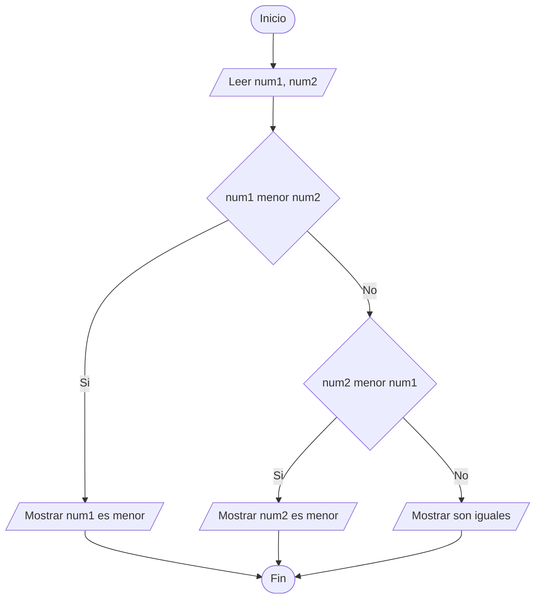
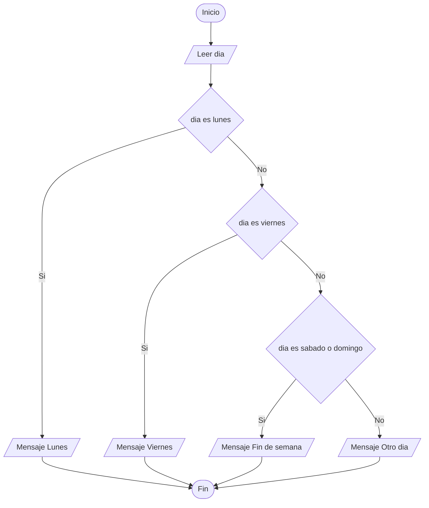
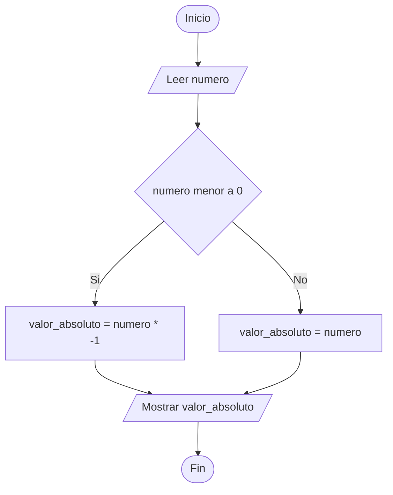
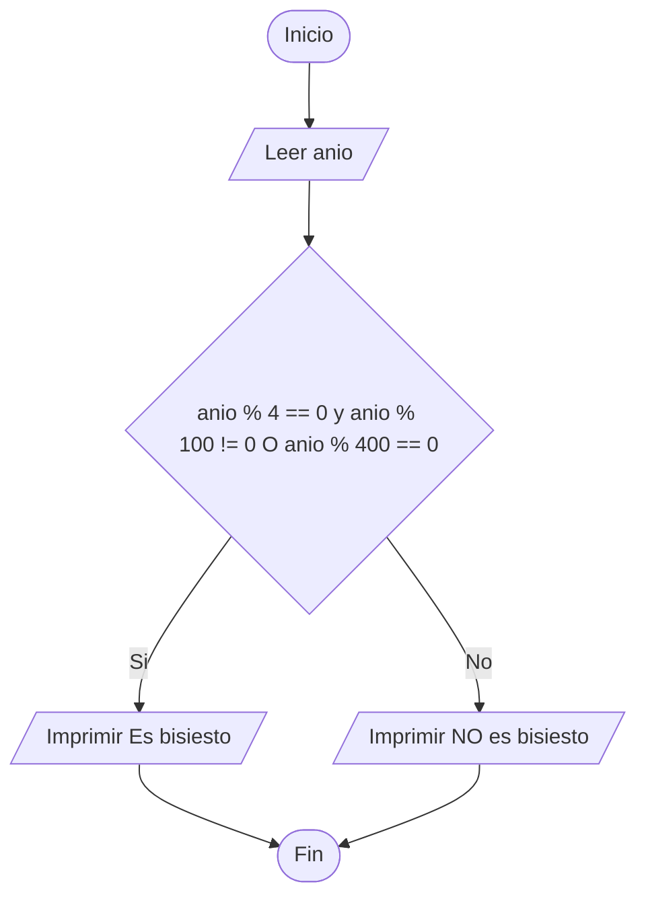
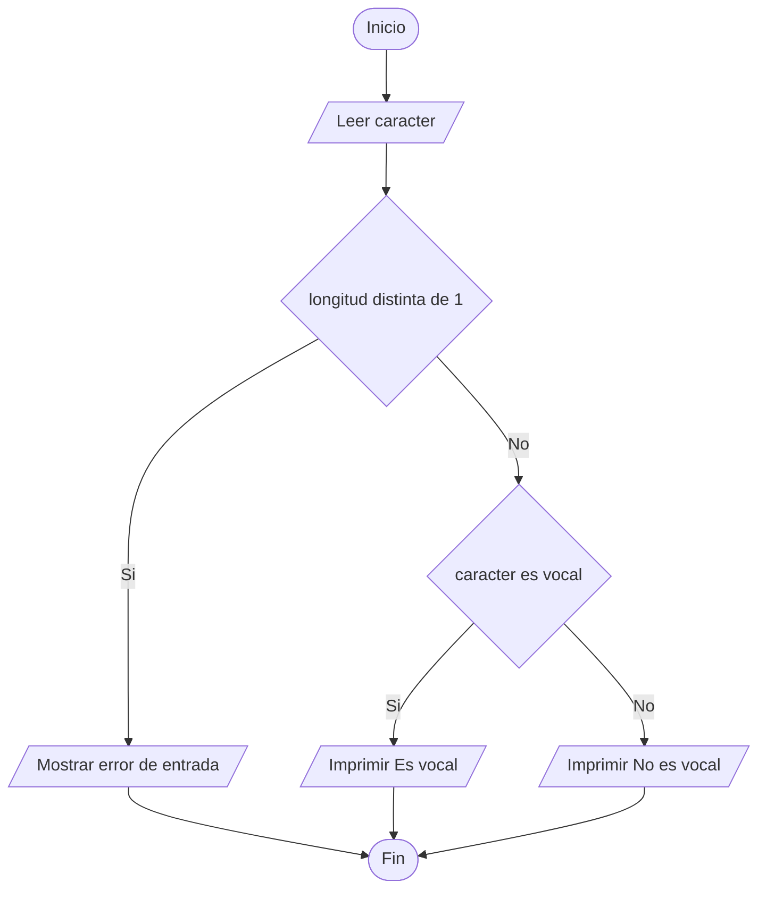
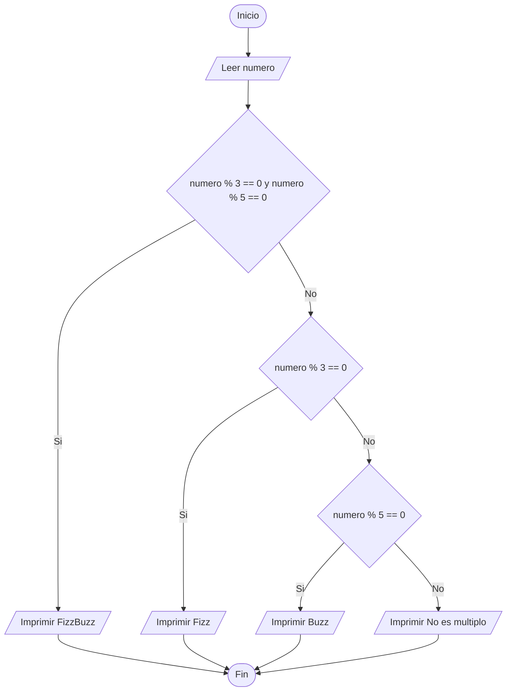
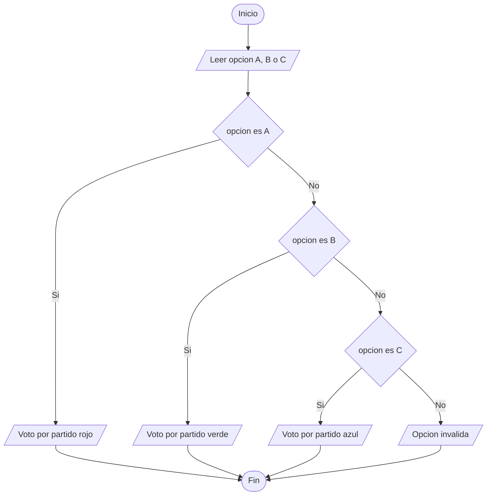
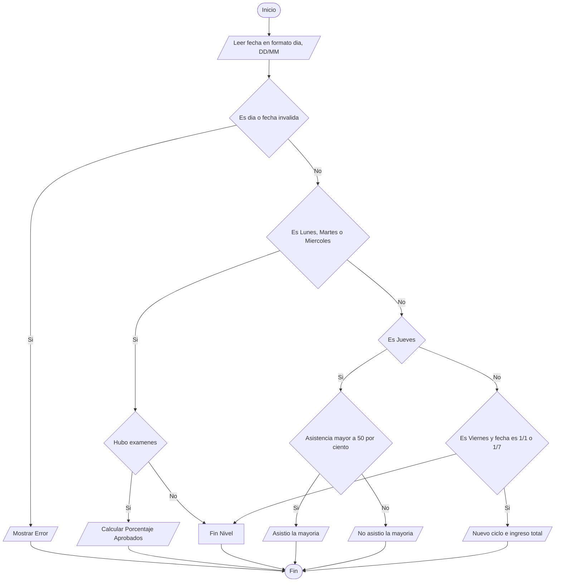

<<<<<<< HEAD
```mermaid
flowchart TD
    subgraph Ejercicio1 [Ejercicio 1: Heladería]
        A1[Inicio] --> B1[total_acumulado = 0.0]
        B1 --> C1{¿Desea hacer un pedido?}
        C1 -- No --> H1[Imprimir total_acumulado final]
        H1 --> I1[Fin Ejercicio 1]
        C1 -- Sí --> D1[Ingresar opción de topping]
        D1 --> E1{¿El topping existe?}
        E1 -- Sí --> F1[Sumar precio del topping + base]
        E1 -- No --> G1[Cobrar solo precio base]
        F1 --> J1[Sumar al total_acumulado]
        G1 --> J1
        J1 --> C1
    end

    subgraph Ejercicio2 [Ejercicio 2: Ordenar Lista]
        A2[Inicio] --> B2[Definir lista original]
        B2 --> C2[Copiar lista para ciclos]
        C2 --> D2[Obtener longitud n]
        D2 --> E2[Ciclo Externo: i en range n]
        E2 --> F2[Ciclo Interno: j en range n - i - 1]
        F2 --> G2{lista j > lista j+1?}
        G2 -- Sí --> H2[Intercambiar elementos]
        H2 --> I2[Siguiente j]
        G2 -- No --> I2
        I2 --> J2{¿Terminó ciclo interno?}
        J2 -- No --> F2
        J2 -- Sí --> K2{¿Terminó ciclo externo?}
        K2 -- No --> E2
        K2 -- Sí --> L2[Verificar con sorted]
        L2 --> M2[Imprimir listas ordenadas]
        M2 --> N2[Fin Ejercicio 2]
    end

    subgraph Ejercicio3 [Ejercicio 3: Subcadenas]
        A3[Inicio] --> B3[Ingresar palabra]
        B3 --> C3[subcadenas = [], n = len palabra]
        C3 --> D3[Ciclo externo: longitud de 1 a n]
        D3 --> E3[Ciclo interno: i de 0 a n - longitud]
        E3 --> F3[Extraer subcadena y agregar a lista]
        F3 --> G3{¿Terminaron las combinaciones?}
        G3 -- No --> E3
        G3 -- Sí --> H3[Ordenar subcadenas key=len]
        H3 --> I3[Ciclo: Imprimir cada subcadena]
        I3 --> J3[Fin Ejercicio 3]
    end

    subgraph Ejercicio4 [Ejercicio 4: Calificaciones]
        A4[Inicio] --> B4[Definir student_scores y student_grades vacío]
        B4 --> C4[Ciclo: Para estudiante, score en items]
        C4 --> D4{score >= 91?}
        D4 -- Sí --> E4[Grade = Outstanding]
        D4 -- No --> F4{score >= 81?}
        F4 -- Sí --> G4[Grade = Exceeds Expectations]
        F4 -- No --> H4{score >= 71?}
        H4 -- Sí --> I4[Grade = Acceptable]
        H4 -- No --> J4[Grade = Fail]
        E4 --> K4[Guardar en student_grades]
        G4 --> K4
        I4 --> K4
        J4 --> K4
        K4 --> L4{¿Más estudiantes?}
        L4 -- Sí --> C4
        L4 -- No --> M4[Imprimir student_grades]
        M4 --> N4[Fin Ejercicio 4]
    end

    subgraph Ejercicio5 [Ejercicio 5: Paseo del Borracho]
        A5[Inicio] --> B5[x = 0, y = 0, paso = 1]
        B5 --> C5{paso <= 100?}
        C5 -- No --> I5[Imprimir ubicación final x, y]
        I5 --> J5[Fin Ejercicio 5]
        C5 -- Sí --> D5[Generar dirección aleatoria 0 a 3]
        D5 --> E5{¿Dirección?}
        E5 -- 0: Arriba --> F1[y = y + 1]
        E5 -- 1: Abajo --> F2[y = y - 1]
        E5 -- 2: Izquierda --> F3[x = x - 1]
        E5 -- 3: Derecha --> F4[x = x + 1]
        F1 --> G5[Incrementar paso en 1]
        F2 --> G5
        F3 --> G5
        F4 --> G5
        G5 --> C5
    end
=======
# Diagramas de Flujo - Taller Condicionales

## Ejercicio 1
```mermaid
graph TD
    A([Inicio]) --> B[/Leer numero/]
    B --> C{numero == 30}
    C -- Si --> D[/Imprimir Ganaste un premio/]
    C -- No --> E[/Imprimir Perdiste/]
    D --> F([Fin])
    E --> F
```

## Ejercicio 2


## Ejercicio 3


## Ejercicio 4


## Ejercicio 5


## Ejercicio 6


## Ejercicio 7


## Ejercicio 8


## Ejercicio 9

>>>>>>> 59723e545cac0e30cf8a1927b25fac40e63a9292
